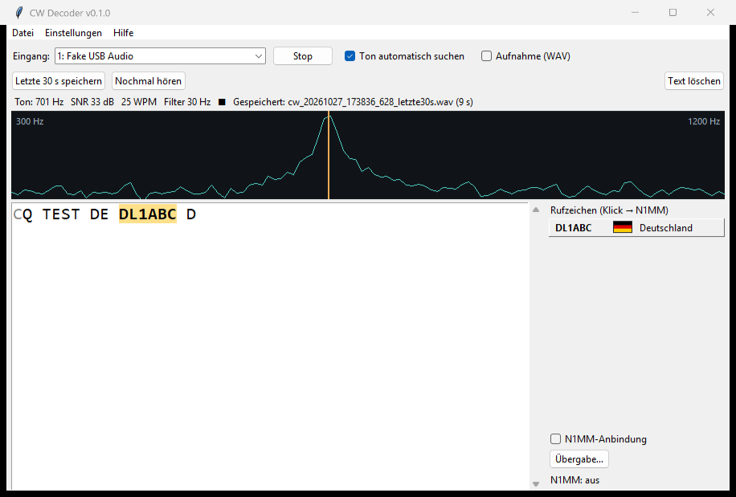
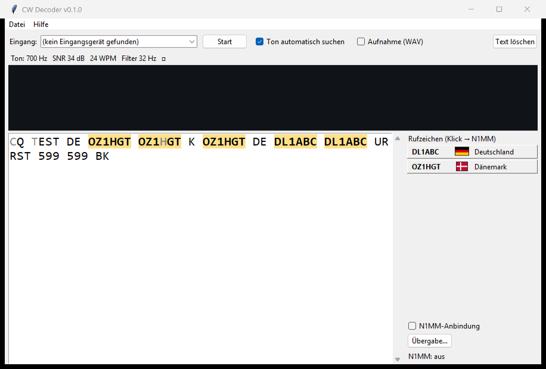
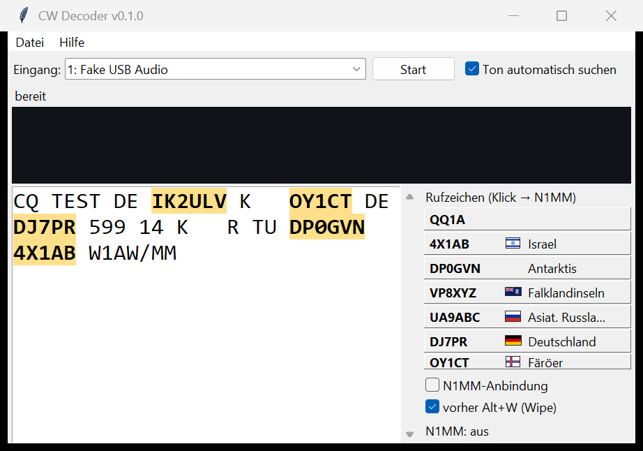

# CW Decoder

Live-Morsedecoder für Audio vom Funkgerät (USB-Audio, VB-Cable, Line-In) mit
automatischer Tonverfolgung, adaptiver Rauschunterdrückung, selbstlernender
Gebegeschwindigkeit und Anbindung an N1MM Logger+.

## Installation (Windows, Setup-Datei)

1. Unter [Releases](https://github.com/kainomatic/cw-decoder/releases) die
   Setup-Datei herunterladen:
   - **Stable:** `CWDecoder-Setup-vX.Y.Z.exe` — für den Funkbetrieb.
   - **Beta:** `CWDecoder-Beta-Setup-vX.Y.Z.exe` (als „Pre-release"
     markiert) — Vorabversion zum Testen.
2. Setup starten und den Assistenten durchklicken (Admin-Rechte nötig,
   Windows 10/11, 64 Bit). Danach steht „CW Decoder" im Startmenü.
3. **Das Programm startet nach der Installation und nach einem Update von
   selbst.** Bitte nicht zusätzlich aus dem Startmenü starten. Der erste
   Start nach einer Installation kann einige Sekunden dauern (der
   Virenscanner prüft die neuen Dateien); solange steht „CW Decoder startet
   …" auf dem Bildschirm. Ein zweiter Start holt das vorhandene Fenster nach
   vorn.

**SmartScreen-Warnung:** Die Setup-Dateien sind nicht signiert (ADR-0015).
Beim ersten Start meldet Windows ggf. „Der Computer wurde durch Windows
geschützt". Dann auf **Weitere Informationen → Trotzdem ausführen**
klicken. Setup-Dateien nur aus den Releases dieses Repos verwenden; sie
werden dort automatisch aus dem getaggten Quelltext gebaut.

**Stable und Beta** sind zwei getrennte Programme und können gleichzeitig
installiert sein und laufen:

| | Stable | Beta |
|---|---|---|
| Startmenü | CW Decoder | CW Decoder Beta (Fenstertitel mit „BETA") |
| Programmordner | `C:\Program Files\CW Decoder` | `C:\Program Files\CW Decoder Beta` |
| Einstellungen, Log | `%APPDATA%\CWDecoder\` | `%APPDATA%\CWDecoder-Beta\` |
| Updates | nur Stable-Releases | nur Beta-Releases |

**Updates:** Kurz nach dem Start fragt das Programm bei GitHub nach einer
neueren Version seines Kanals (abschaltbar über den Haken „Nicht mehr an
Updates erinnern"; `update_check` in `config.json`). Ist eine da, zeigt ein
Dialog die neue Version und einen Link zu den Änderungen.
„Herunterladen und installieren" lädt das Setup, beendet den CW Decoder,
installiert still (Windows fragt nach Admin-Rechten) und startet die neue
Version. „Später" lässt einen Hinweis im Hilfe-Menü stehen. Von Hand:
**Hilfe → Nach Updates suchen**. Ohne Internet startet das Programm normal.

**Deinstallieren** über Windows-Einstellungen → Apps. Die Frage, ob
Einstellungen und Logs gelöscht werden sollen, ist mit „Nein" vorbelegt;
Aufnahmen bleiben immer erhalten.

## Entwicklung (aus dem Quelltext)

```
python -m venv .venv
.venv\Scripts\activate
pip install -r requirements.txt
```

Python 3.12 (Referenzversion). `sounddevice` bringt PortAudio mit, es muss
nichts weiter installiert werden. Für die Tests zusätzlich
`pip install -r requirements-dev.txt`. EXE und Installer selbst bauen:
`docs/BUILD.md`.

## Benutzung

Geräte anzeigen:

```
python -m cwdecoder.live --list
```

Live im Terminal (Gerät per Nummer oder Namensteil):

```
python -m cwdecoder.live --device "USB Audio"
python -m cwdecoder.live --device 3 --record qso.wav
```

Grafische Oberfläche mit Spektrum, Text, Rufzeichen-Buttons und N1MM:

```
python -m cwdecoder.gui
python -m cwdecoder.gui --n1mm   # N1MM-Anbindung gleich beim Start an
python -m cwdecoder.gui --n1mm-engine   # dazu Engine für N1MMs CW Reader
```

Die N1MM-Anbindung ist standardmäßig aus und belegt erst Ports (UDP 12060,
TCP 7373, XML-RPC 7367), wenn der Haken "N1MM-Anbindung" gesetzt wird.
Welche Wege ein Klick auf ein Rufzeichen auslöst, steht unter „Übergabe…".

Erkannte Rufzeichen stehen rechts als Knöpfe, neueste oben, mit Flagge und
Landesname (DXCC-Entität aus `cty.dat`, ADR-0021); der Tooltip nennt
Hauptpräfix, Kontinent und CQ-/ITU-Zone. Im Text sind sie markiert. Ein
Klick auf Knopf oder Markierung übergibt das Rufzeichen an N1MM. Die
Spalte zeigt so viele Knöpfe, wie hineinpassen; ältere Rufzeichen stehen
im Text und sind dort anklickbar.

Unsicher erkannte Zeichen stehen im Text **grau** (ein Element lag knapp
zwischen Punkt und Strich, das Tempo war noch nicht eingemessen oder das
Signal schwach; ADR-0023). Dort lohnt es sich, selbst hinzuhören. Enthält
ein Rufzeichen solche Zeichen, sagt es der Tooltip von Knopf und
Markierung („enthält unsichere Zeichen"). Im Terminal (`live`,
`decode_wav`) sind unsichere Zeichen klein geschrieben: `CQ TEST OZ1hGT`.

**Letzte 30 s speichern** (Strg+S) sichert die letzten Sekunden Audio als
WAV in `Dokumente\CW Decoder\Aufnahmen` (`cw_…_letzte30s.wav`), daneben
den decodierten Text dieses Ausschnitts als `.txt` – ohne Daueraufnahme.
**Nochmal hören** (Strg+R) spielt die letzten 10 s über das
Standard-Ausgabegerät ab, der Decoder läuft weiter; ein zweiter Klick
(„Stopp") bricht ab. Längen, Puffergröße (Standard 60 s) und „langsamer
(0,7×)" ohne Tonhöhenänderung stehen unter Einstellungen → „Puffer und
Nochmal hören…" (ADR-0024).







Installiert heißt das Programm `CWDecoder.exe`; dieselben Funktionen gibt
es dort per Kommandozeile: `CWDecoder.exe --decode datei.wav`,
`CWDecoder.exe --list-devices`, `CWDecoder.exe --version`,
`CWDecoder.exe --dxcc DJ7PR` (Land zum Rufzeichen; aus dem Quelltext:
`python -m cwdecoder.dxcc DJ7PR`).

Die GUI merkt sich Gerät, feste Tonfrequenz und die Haken. Ablageorte:

| Was | Wo (Windows) |
|-----|--------------|
| Einstellungen, Log, Lockfile | `%APPDATA%\CWDecoder\` (`config.json`, `logs\cwdecoder.log`); Beta: `%APPDATA%\CWDecoder-Beta\` |
| Aufnahmen (Haken "Aufnahme", Strg+S) | `Dokumente\CW Decoder\Aufnahmen\` (Datei → Aufnahmeordner öffnen) |

Den Log-Ordner öffnet auch **Hilfe → Log-Ordner öffnen**.

Probleme melden: Hilfe → Fehler melden… zeigt einen Bericht (Version, System,
Audiogerät, letzte Logzeilen) und öffnet auf Wunsch ein vorausgefülltes
GitHub-Issue im Browser. Das Programm sendet selbst nichts.

Ein Klick ins Spektrum setzt die Tonfrequenz fest (Haken "Ton automatisch
suchen" geht aus); Haken wieder setzen schaltet zurück auf Automatik.

WAV-Datei offline decodieren (zum Tunen und zum Nachstellen von Problemen):

```
python -m cwdecoder.decode_wav aufnahme.wav
python -m cwdecoder.decode_wav aufnahme.wav --expect "CQ TEST DE DL1ABC" --trace
```

Testsignal erzeugen:

```
python -m cwdecoder.gen "CQ TEST DE DL1ABC K" -o test.wav --wpm 28 --snr 6 --drift 60 --qsb 0.4 --qsb-depth 0.7
```

Tests und Testmatrix (zufällige Texte; Tempi, SNR, Drift, QSB, QRM, Timing,
reines Rauschen; `--legacy` für die alte Matrix):

```
pytest
python tests/run_matrix.py
python tests/run_matrix.py --real     # Texte der echten Aufnahmen, Ähnlichkeit zum Stand
python tests/run_matrix.py --real-baseline   # Stand neu speichern (tests/real_baseline.json)
```

Testdaten: `testdata/real/` enthält echte Aufnahmen vom Funkgerät
(`tests/test_real.py`; der Volltext aller Aufnahmen zu einem festen Stand
steht in `tests/real_baseline.json`). Es sind Mitschnitte öffentlichen
Amateurfunkverkehrs; auf Wunsch einer betroffenen Station wird die
jeweilige Aufnahme entfernt. Fehlfälle im Betrieb mit **Strg+S** sichern
(`…_letzte30s.wav` samt `.txt`) und nach `testdata/` kopieren; auswerten
mit `python -m cwdecoder.decode_wav datei.wav --trace`.

## Wie es funktioniert

1. **Tonverfolgung** (`dsp.ToneTracker`): FFT über 128 ms, alle 16 ms, im
   Bereich 300–1200 Hz. Max-Hold mit Abklingen hält den Ton auch über
   Tastpausen fest. Der Peak (mit Sub-Bin-Interpolation) wird in einem
   Fenster von ±60 Hz weich nachgeführt und folgt so einer Drift; auf eine
   andere Linie wird nur umgeschaltet, wenn sie mindestens 3 dB stärker ist.
   Als Ton gilt nur eine schmale Linie (≥ 9 dB über dem Umfeld ±20…40 Hz);
   Rauschen hinter einem schmalen CW-Filter im Funkgerät zählt nicht.
2. **Hüllkurve** (`dsp.Envelope`): Quadraturmischer auf 0 Hz plus Tiefpass
   3. Ordnung. Die Filterbandbreite wird aus der erkannten Geschwindigkeit
   abgeleitet (langsam = schmal = weniger Rauschen, schnell = breiter), mit
   Grenzen 25–150 Hz.
3. **Schwelle** (`dsp.Thresholder`): Rauschteppich als Mittelwert im linearen
   Bereich, Signalpegel mit schnellem Anstieg und langsamem Abfall (bei
   Tastung an schneller, damit QSB nachgeführt wird). Ein-/Ausschaltschwelle
   liegen 6 bzw. 10 dB unter dem Signalpegel, bei schwachem Signal
   proportional zwischen Rauschen und Signal. Squelch bei < 10 dB Abstand,
   bei zu wenig Dynamik der Hüllkurve (< 20 dB über 2 s) oder ohne Linie;
   Entprellung relativ zur Punktlänge.
4. **Timing** (`timing.TimingDecoder`): Punktlänge wird laufend aus den
   letzten 24 Ton- und Pausenlängen per Clusterung geschätzt (Punkte/Striche,
   Element-/Zeichenpausen). Die Wortschwelle passt sich an gedehnte
   Zeichenabstände (Farnsworth) an. Zeichen werden per Timeout ausgegeben,
   nicht erst beim nächsten Ton. Tempo 5–60 WPM; nach Tonverlust wird es
   für die nächste Station neu eingemessen.
5. **Rufzeichen** (`callsign.py`): Wörter, die wie Rufzeichen aussehen,
   erscheinen als Buttons in der GUI. Auch zusammengeklebte Rufzeichen
   (`DEDJ7PR`) werden gefunden; bekannte Rufzeichen auch, wenn sie zerrissen
   sind (`OY 1 CT`) (ADR-0019).

Im Textfenster beginnt nach einer Pause von mehr als 3 s oder wenn der Ton
weg ist ein neuer Absatz. Bei aktiver Aufnahme entsteht neben der WAV eine
gleichnamige `.txt` mit einer Zeile je Zeichen: `sekunde;zeichen;vertrauen`
(Sekunde ab Aufnahmebeginn, Vertrauen 0…1, unter 0,50 = unsicher;
Wortabstand als Leerzeichen, Absatz als `¶`, beide ohne Vertrauen). Damit
lässt sich eine Stelle im Text in der Aufnahme wiederfinden. Logs aus
Versionen vor beta12 haben nur die ersten zwei Spalten.

Eine einmalige Vergleichsmessung gegen fldigi 4.2.03, die übliche Engine
hinter N1MMs CW Reader, steht in [`docs/VERGLEICH.md`](docs/VERGLEICH.md):
Testmatrix 81,5 % gegen 97,7 %, echte Aufnahmen 30 % gegen 90 %. Die
Unterschiede liegen vor allem bei Tempo-Einmessung, Rauschsperre und
Wortgrenzen.

## N1MM Logger+

Schritt-für-Schritt-Anleitung und Fehlersuche: [`docs/N1MM.md`](docs/N1MM.md)
(ADR-0022).

- **CW Reader von N1MM** (Standard): Der CW Decoder gibt sich als fldigi
  aus (XML-RPC, Port 7367). In N1MM unter Window → CW Reader → Setup →
  Fldigi den Pfad zu `CWDecoder.exe` eintragen. N1MM zeigt unseren Text,
  markiert die Rufzeichen, und ein Klick setzt sie ins Entry Window.
- **Skimmer-Spot** (Standard an): Mini-DX-Cluster auf `127.0.0.1:7373`
  (N1MM: Window → Telnet). Ein Klick auf ein Rufzeichen im CW Decoder
  schickt einen Spot auf der aktuellen Frequenz.
- **Entry Window tippen** und **Zwischenablage** (Standard aus): unter
  „Übergabe…" im CW Decoder wählbar.

Damit das Programm die Frequenz kennt: in N1MM unter Config → Configure
Ports → Broadcast Data den Haken bei "Radio" setzen (Standard
`127.0.0.1:12060`).

## Projektstruktur

```
cwdecoder/
  gen.py         Testsignal-Generator (Text -> WAV mit Störungen)
  dsp.py         Decimator, ToneTracker, Envelope, Thresholder
  timing.py      Geschwindigkeits-Schätzung, Punkt/Strich/Pausen -> Zeichen
  morse.py       Morsetabelle inkl. Prosigns
  decoder.py     Gesamtkette (CWDecoder)
  decode_wav.py  Offline-Decoder mit Bewertung
  live.py        Soundkarte -> Terminal
  ringbuffer.py  Ringpuffer (Audio, Decoder-Ausgabe), letzte Sekunden speichern
  replay.py      Nochmal hören (Wiedergabe, Zeitdehnung ohne Tonhöhenänderung)
  gui.py         Tkinter-Oberfläche
  callsign.py    Rufzeichen-Erkennung
  dxcc.py        Rufzeichen -> Land (cty.dat), Flaggen
  data/          cty.dat, dxcc_table.json (deutsche Namen), flags/*.png
  n1mm.py        RadioInfo-UDP, Tastatur-Übergabe, Spot-Server
  __version__.py Version und Kanal (stable/beta)
  paths.py       Ablageorte (App-Ordner, Log, Aufnahmen)
  config.py      Einstellungen (config.json)
  logging_setup.py  Diagnose-Log
  gui_tooltip.py, gui_errors.py, gui_error_report.py, gui_ring.py  GUI-Bausteine
  error_report.py   Fehlerbericht
  instance_lock.py  Schutz gegen Doppelstart
  app_mutex.py      benannter Mutex für den Installer
  updater.py, gui_update.py  Self-Update (Prüfung, Download, Dialog)
  app_main.py       Einstieg der EXE (GUI, --decode, --list-devices, --version, --dxcc)
run_cwdecoder.py   Einstieg für PyInstaller
cwdecoder.spec     PyInstaller-Build
installer/         Inno-Setup-Skripte (Stable, Beta)
tools/             make_icon.py, release_tools.py (Release-Workflow),
                   update_cty.py, make_flags.py (DXCC-Daten, Flaggen)
tests/
  test_*.py      pytest
  run_matrix.py  Testmatrix
  gui_smoke.py   GUI-Rauchtest mit Fake-Soundkarte
docs/adr/        Architekturentscheidungen
docs/BUILD.md    EXE und Installer bauen
docs/N1MM.md     Anbindung an N1MM Logger+
docs/VERGLEICH.md  Vergleichsmessung gegen fldigi
```

## Stand / offene Punkte

- Die DSP-Kette ist gegen synthetische Signale getestet (Testmatrix mit
  zufälligen Texten ~97 % Zeichen-Übereinstimmung, bis ca. 0 dB SNR in
  2,4 kHz; bei reinem Rauschen keine Ausgabe). Echte Aufnahmen
  vom Funkgerät (`--record`) sind der nächste Schritt zum Feintuning.
- Die GUI und die Tastatur-Übergabe an N1MM wurden unter Linux ohne
  Display geschrieben und müssen unter Windows einmal durchgeklickt werden.
- Mögliche Erweiterungen: mehrere Signale gleichzeitig (Multi-Decoder über
  das Band), Wahrscheinlichkeits-Decoder statt harter Schwellen bei sehr
  schwachen Signalen, Rufzeichen-Plausibilität über Master-Callsign-Datei.

## Lizenz

Copyright (C) 2026 DF1DS (kainomatic). GNU General Public License v3.0 oder
später (GPL-3.0-or-later), siehe `LICENSE`. Mitgelieferte fremde Daten
(`cty.dat`, Flaggen) und ihre Lizenzen: `THIRD_PARTY.md`.
